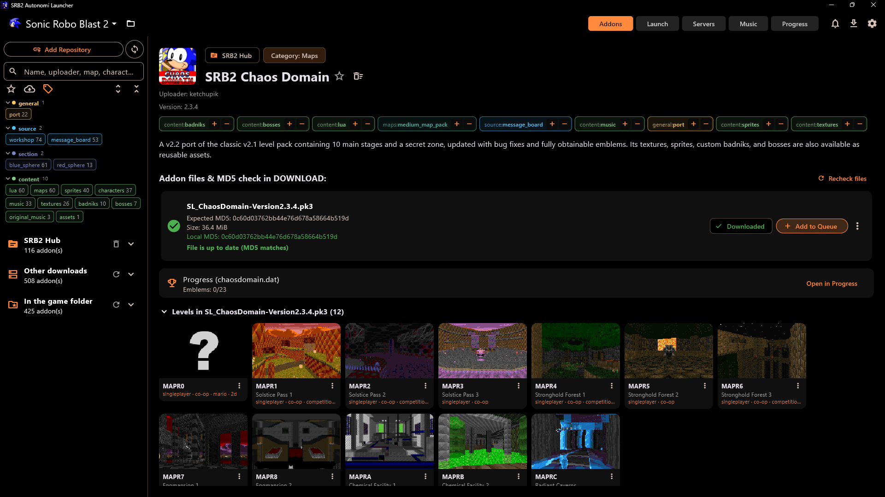
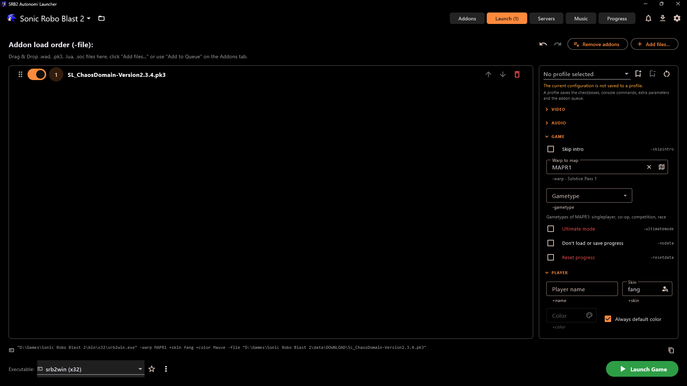
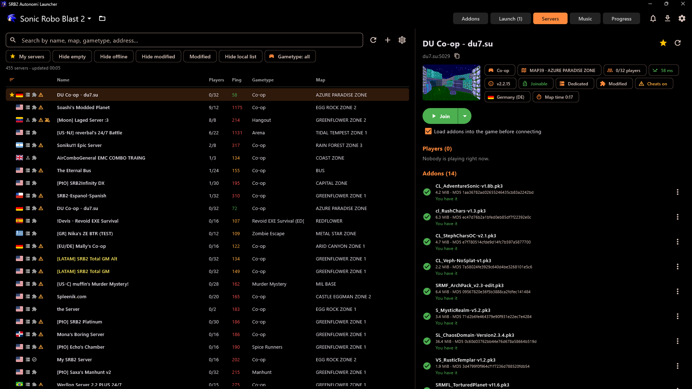
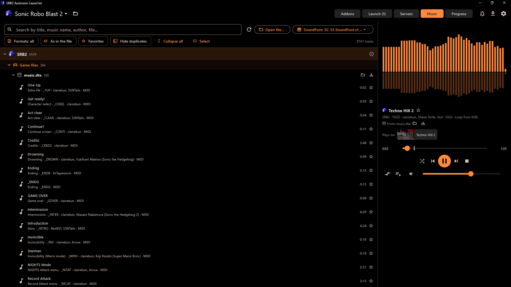
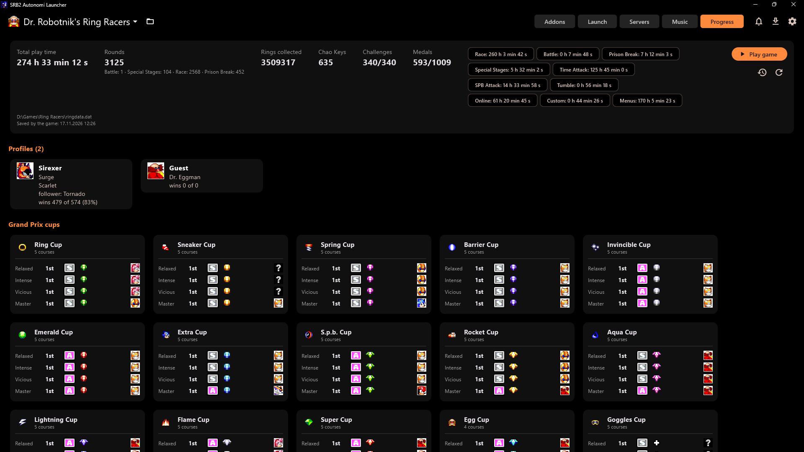

# SRB2 Autonomi Launcher

**English** | [Русский](README.ru.md)

Versatile launcher for SRB2 — its main feature is downloading add-ons using
[Autonomi](https://autonomi.com).

The launcher connects add-on repositories, downloads files from the Autonomi
network (through the `antd` daemon, which ships with the launcher and starts
by itself), checks them by MD5 and starts the game with the chosen add-ons.



Supported games: **Sonic Robo Blast 2**, **SRB2 Legacy**, **SRB2Kart**,
**Dr. Robotnik's Ring Racers** and custom forks described in JSON (BlanKart
comes with the launcher).

Platforms: **Windows x64**, **Linux x86_64** (AppImage) and **Linux ARM64**
(build from source).

## Features

- **Add-ons from Autonomi** — repositories by address or pointer, updated by
  themselves; versions side by side, a download queue, search with tags.
- **What is inside** — levels with pictures, characters with icons, gametypes
  and skin colors of every downloaded file.
- **Launch** — launch queue with undo, several executables, all game options,
  profiles, map and character pickers.
- **Servers** — server list with country flags, filters and a blacklist;
  joining downloads the missing add-ons first (repositories, HTTP mirror or
  the server itself).
- **Music player** (experimental) — the music of the games and add-ons: OGG,
  MP3, MIDI (SoundFont or a MIDI device), tracker modules and console music.
- **Progress** (experimental) — single player progress, records and emblems,
  like the game's Statistics.
- **Replays** (experimental) — browse `.lmp` replays across SRB2, SRB2
  Legacy, SRB2Kart, Ring Racers and BlanKart, import from disk or URL,
  inspect maps/characters/add-ons, add extra add-ons and launch playback.
- **Save protection** (experimental) — a whole copy of every save, restored if
  the file gets damaged.
- **3D models** — download repository model packs or add local ones, put
  several packs together into one (including multiple versions per archive),
  pick the version of each model in a 3D preview, install to the game with a
  backup and roll back, or save as `.zip`.
- **Themes** — colors, background pictures, fonts, corners, window opacity.
- **Updates** — new releases are offered and installed by the launcher.
- Six languages: English, Russian, Ukrainian, German, Spanish, Portuguese.

| <a href="docs/images/launch.png"></a><br>Launch | <a href="docs/images/servers.png"></a><br>Servers |
|:-:|:-:|
| <a href="docs/images/player.png"></a><br>Music player | <a href="docs/images/progress.png"></a><br>Progress (Ring Racers) |

## Download

Get the latest release from
[Releases](https://github.com/Sirexer/SRB2-autonomi-launcher/releases):

- **Windows** — `SRB2-Autonomi-Launcher-windows-x64.zip`: unpack it anywhere
  and run `srb2al.exe`. The Visual C++ runtime is included.
- **Linux** — `SRB2-Autonomi-Launcher-x86_64.AppImage`:
  ```bash
  chmod +x SRB2-Autonomi-Launcher-x86_64.AppImage
  ```
  ```bash
  ./SRB2-Autonomi-Launcher-x86_64.AppImage
  ```

**Portable mode**: put an empty file named `portable` next to `srb2al.exe`
(or the `.AppImage`) — settings and cache are then kept in `user_data` next to
the launcher.

## First start

A short wizard asks for:

1. language and theme (your system's language is preselected);
2. the add-on repository from `pointer.txt` next to the launcher;
3. which games to show and their folders and executables (found ones are
   filled in);
4. experimental features: music player, progress, replays, save protection.

Everything can be changed later in Settings.

## Quick start

1. **Addons** — pick an add-on, choose a version, **Download**, then **Add to
   Queue**.
2. **Launch** — check the queue and options, press **Launch Game**.
3. **Servers** — pick a server and **Join**: missing add-ons are downloaded
   first.

## Documentation

| For | Read |
|---|---|
| Players | [Games](docs/guide/games.md) · [Addons](docs/guide/addons.md) · [Launch](docs/guide/launch.md) · [Servers](docs/guide/servers.md) · [Player](docs/guide/player.md) · [Progress](docs/guide/progress.md) · [Replays](docs/guide/replays.md) · [Save protection](docs/guide/save-protection.md) · [Settings](docs/guide/settings.md) |
| Theme makers | [Themes](docs/themes.md) |
| Repository authors | [Repository format](docs/manifest-format.md) |
| Fork authors | [Custom games](docs/custom-games.md) |
| Translators | [Translations](docs/translations.md) |
| Developers | [Building and releasing](docs/building.md) · [Internals](docs/internals.md) |

## Building

Flutter 3.47.9, then:

```bash
bash packaging/build_linux.sh
```
```bash
powershell -ExecutionPolicy Bypass -File packaging\build_windows.ps1
```

Details, dependencies and releasing: [docs/building.md](docs/building.md).

## License

SRB2 Autonomi Launcher is free software under the **GNU General Public
License version 2** ([LICENSE](LICENSE)): it contains data from the games'
GPL-2.0 sources (SRB2 Legacy and SRB2Kart emblems, hints and secrets; built-in
colors of SRB2 2.2, SRB2Kart and Ring Racers).

Attribution for data shipped with the launcher (server countries — IP
Geolocation by [DB-IP](https://db-ip.com), CC BY 4.0; flags —
[flag-icons](https://github.com/lipis/flag-icons), MIT) is in `NOTICE.txt`
next to the launcher (`packaging/NOTICE.txt` in the repository).

`antd` and `third_party/antd_client` come from
[ant-sdk](https://github.com/WithAutonomi/ant-sdk) (Autonomi), MIT or
Apache-2.0 at your option; their license files are next to them (`antd/`,
`third_party/antd_client/`).
