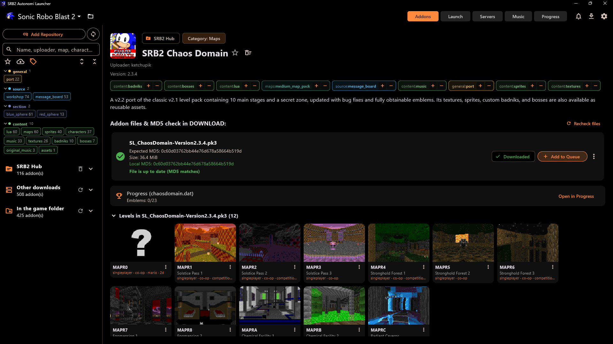
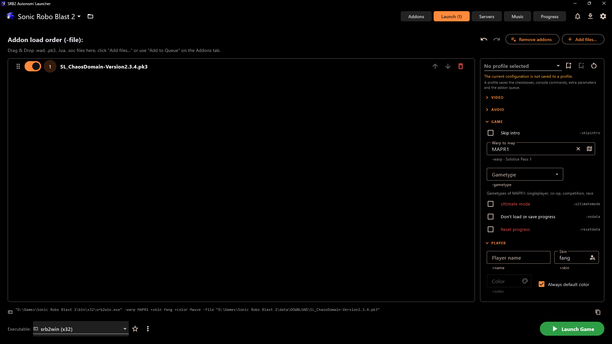
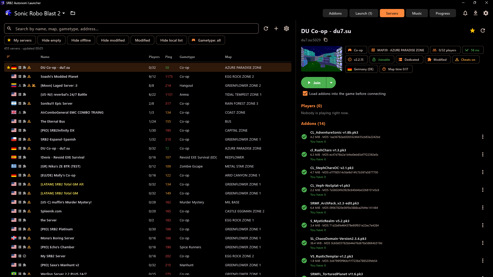
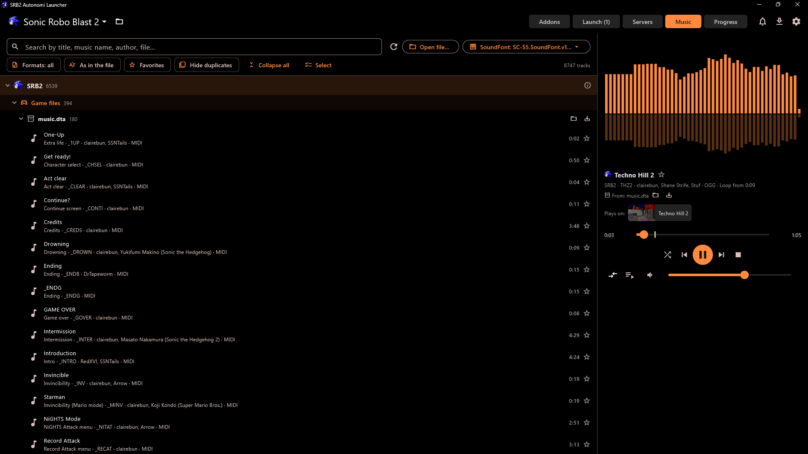
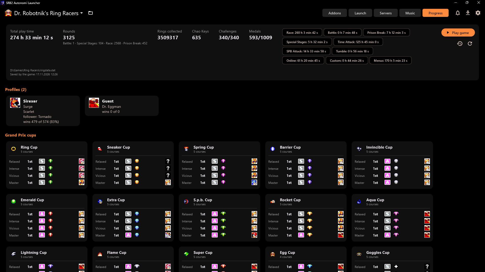

# SRB2 Autonomi Launcher

[English](README.md) | **Русский**

Многофункциональный лаунчер для SRB2 — главное в нём: аддоны скачиваются через
сеть [Autonomi](https://autonomi.com).

Лаунчер подключает репозитории аддонов, скачивает файлы из сети Autonomi
(через демон `antd`, который идёт вместе с лаунчером и запускается сам),
проверяет их по MD5 и запускает игру с выбранными аддонами.



Игры: **Sonic Robo Blast 2**, **SRB2 Legacy**, **SRB2Kart**, **Dr. Robotnik's
Ring Racers** и свои форки, описанные в JSON (BlanKart идёт вместе с
лаунчером).

Платформы: **Windows x64**, **Linux x86_64** (AppImage) и **Linux ARM64**
(сборка из исходников).

## Возможности

- **Аддоны из Autonomi** — репозитории по адресу или pointer, обновляются
  сами; версии хранятся рядом, очередь загрузок, поиск по тегам.
- **Что внутри** — уровни с картинками, персонажи с иконками, режимы и цвета
  каждого скачанного файла.
- **Запуск** — очередь с отменой, несколько сборок, все параметры игры,
  профили, выбор карты и персонажа.
- **Серверы** — список с флагами стран, фильтрами и чёрным списком; при входе
  недостающие аддоны скачиваются заранее (из репозиториев, с HTTP-зеркала или
  с самого сервера).
- **Плеер** (экспериментально) — музыка игр и аддонов: OGG, MP3, MIDI
  (SoundFont или MIDI-устройство), трекерные модули и музыка приставок.
- **Прогресс** (экспериментально) — прогресс одиночной игры, рекорды и
  эмблемы, как экран Statistics в игре.
- **Защита сохранений** (экспериментально) — целая копия каждого сохранения,
  которая возвращается, если файл повредился.
- **3D-модели** — несколько наборов моделей в один пак: версия каждой модели
  выбирается в 3D-просмотре, пак ставится в игру с резервной копией и
  откатом или сохраняется в `.zip`.
- **Темы** — цвета, картинка на фоне, шрифты, углы, прозрачность окна.
- **Обновления** — лаунчер сам предлагает и ставит новые версии.
- Шесть языков: английский, русский, украинский, немецкий, испанский,
  португальский.

| <a href="docs/images/launch.png"></a><br>Запуск | <a href="docs/images/servers.png"></a><br>Серверы |
|:-:|:-:|
| <a href="docs/images/player.png"></a><br>Плеер | <a href="docs/images/progress.png"></a><br>Прогресс (Ring Racers) |

## Скачать

Последняя версия — на странице
[Releases](https://github.com/Sirexer/SRB2-autonomi-launcher/releases):

- **Windows** — `SRB2-Autonomi-Launcher-windows-x64.zip`: распакуйте в любую
  папку и запустите `srb2al.exe`. Visual C++ runtime уже в архиве.
- **Linux** — `SRB2-Autonomi-Launcher-x86_64.AppImage`:
  ```bash
  chmod +x SRB2-Autonomi-Launcher-x86_64.AppImage
  ```
  ```bash
  ./SRB2-Autonomi-Launcher-x86_64.AppImage
  ```

**Портативный режим**: положите рядом с `srb2al.exe` (или `.AppImage`)
пустой файл `portable` — настройки и кэш будут в папке `user_data` рядом с
лаунчером.

## Первый запуск

Короткий мастер спросит:

1. язык и тему (сразу выбран язык системы);
2. подключить ли репозиторий аддонов из `pointer.txt` рядом с лаунчером;
3. какие игры показывать, их папки и исполняемые файлы (найденные
   подставляются сами);
4. экспериментальные функции: плеер, прогресс, защита сохранений.

Всё это потом меняется в настройках.

## Как начать

1. **Аддоны** — выберите аддон и версию, **Скачать**, затем **В очередь**.
2. **Запуск** — проверьте очередь и параметры, нажмите **Запустить игру**.
3. **Серверы** — выберите сервер и **Подключиться**: недостающие аддоны
   скачаются заранее.

## Документация

| Кому | Что читать |
|---|---|
| Игрокам | [Игры](docs/guide/games.ru.md) · [Аддоны](docs/guide/addons.ru.md) · [Запуск](docs/guide/launch.ru.md) · [Серверы](docs/guide/servers.ru.md) · [Плеер](docs/guide/player.ru.md) · [Прогресс](docs/guide/progress.ru.md) · [Защита сохранений](docs/guide/save-protection.ru.md) · [Настройки](docs/guide/settings.ru.md) |
| Создателям тем | [Темы](docs/themes.ru.md) |
| Авторам репозиториев | [Формат репозитория](docs/manifest-format.ru.md) |
| Авторам форков | [Свои игры](docs/custom-games.ru.md) |
| Переводчикам | [Переводы](docs/translations.ru.md) |
| Разработчикам | [Сборка и выпуск](docs/building.ru.md) · [Как это устроено](docs/internals.ru.md) |

## Сборка

Flutter 3.47.9, затем:

```bash
bash packaging/build_linux.sh
```
```bash
powershell -ExecutionPolicy Bypass -File packaging\build_windows.ps1
```

Подробности, зависимости и выпуск релиза — в
[docs/building.ru.md](docs/building.ru.md).

## Лицензия

SRB2 Autonomi Launcher — свободная программа под **GNU General Public
License версии 2** ([LICENSE](LICENSE)): в лаунчере есть данные из исходников
игр под GPL-2.0 (эмблемы, подсказки и секреты SRB2 Legacy и SRB2Kart,
встроенные цвета SRB2 2.2, SRB2Kart и Ring Racers).

Указание авторства данных, которые идут с лаунчером (страны серверов —
IP Geolocation by [DB-IP](https://db-ip.com), CC BY 4.0; флаги —
[flag-icons](https://github.com/lipis/flag-icons), MIT), — в файле
`NOTICE.txt` рядом с лаунчером (в репозитории — `packaging/NOTICE.txt`).

`antd` и `third_party/antd_client` — из
[ant-sdk](https://github.com/WithAutonomi/ant-sdk) (Autonomi), лицензия MIT
или Apache-2.0 на выбор; файлы лицензий лежат рядом с ними (`antd/`,
`third_party/antd_client/`).
